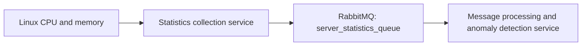

# Server Statistics Collection Service

A Linux statistics producer built with C# and .NET 9. It periodically reads CPU
and memory usage, serializes each reading as JSON, and publishes it to RabbitMQ
for downstream processing.

This repository supplies the collection stage of the monitoring pipeline. The
[Message Processing and Anomaly Detection Service](https://github.com/none-empty/Message_Processing_and_Anomaly_Detection_Service)
is the consumer of the RabbitMQ messages published by this service.

## How the projects fit together



This service collects and publishes statistics; the companion repository consumes
them for processing and anomaly detection. The two services communicate through
RabbitMQ using the same queue name and JSON fields.

This repository's Compose deployment starts the collector and, when needed,
RabbitMQ. Run the consumer separately using the companion project's configuration.

### Queue configuration

Both applications must connect to the same broker and virtual host (`/`) and
agree on the queue declaration:

| Property | Value |
| --- | --- |
| Queue | `server_statistics_queue` |
| Durable | `true` |
| Exclusive | `false` |
| Auto-delete | `false` |

Durable queues also avoid RabbitMQ 4.3's default rejection of non-durable,
non-exclusive queues; see the [RabbitMQ queue documentation](https://www.rabbitmq.com/docs/queues).
If an older non-durable queue already exists, drain and migrate it before
recreating it as durable. Changing the declaration does not convert an existing
queue in place.

## Collection and publishing

Each iteration of the background service:

1. Reads used and available memory from `free -m`.
2. Reads CPU usage from `top -bn1`, calculating `100 - idle percentage`.
3. Adds a UTC timestamp and the configured server identifier.
4. Publishes the JSON reading to `server_statistics_queue`.
5. Waits for `SamplingIntervalSeconds` before taking the next sample.

The default delay is five seconds. Collection and publishing take additional
time, so this is a delay between iterations rather than a fixed wall-clock rate.
Give each monitored server a distinct `ServerIdentifier` so the processor can
compare readings from the same source.

The collector supports Linux. When run in Docker, it reads the system information
visible to the container; these values are not calculated from container CPU or
memory limits and are not a dedicated measurement of this application's resource
usage.

### Message format

Example JSON payload:

```json
{
  "MemoryUsage": 4096,
  "AvailableMemory": 8192,
  "CpuUsage": 23.5,
  "Timestamp": "2026-11-04T12:00:00Z",
  "ServerIdentifier": "producer1"
}
```

| Field | Meaning |
| --- | --- |
| `MemoryUsage` | Used memory reported by `free -m`, in MiB. |
| `AvailableMemory` | Available memory reported by `free -m`, in MiB. |
| `CpuUsage` | CPU usage percentage. |
| `Timestamp` | UTC time when the reading was assembled. |
| `ServerIdentifier` | Identifier used to associate readings with a server. |

The producer uses the default exchange (`""`) with the queue name as its routing
key. It declares the queue before its first publish, marks messages persistent,
and enables publisher confirmations. One connection and publishing channel are
reused, with publishing serialized through a semaphore. Resources are disposed
when the host shuts down.

Automatic connection and topology recovery are enabled. Selected connection,
I/O, and timeout failures are logged, and the service attempts the next sample
after the configured delay. A failed sample is not saved locally for later replay.

## Run with Docker Compose

Requirements:

- Docker Engine with Docker Compose 2.20.0 or newer, for Compose `include` support.
- Access to the image and package registries during the first pull/build.

Run commands from the repository root.

### Start with the bundled RabbitMQ

```sh
cp .env.example .env
docker compose up -d --build
```

The example leaves the broker hostname, username, and password empty. Compose:

- Pulls `rabbitmq:4-management` if the image is not already available locally.
- Builds the statistics service image, including `bash` and `procps` for collection.
- Starts both containers on the project's `messaging` bridge network.
- Waits for RabbitMQ's health check before starting the collector.
- Connects the collector to `rabbitmq:5672`, with `guest` / `guest` by default.

The queue appears after the first successful publication. Open
[the management UI](http://localhost:15672), sign in with the configured username
and password, and select **Queues and Streams** in virtual host **`/`**.

| Access from | Address |
| --- | --- |
| Browser on the Docker host | `http://localhost:15672` |
| Application running directly on the Docker host | `localhost:5672` |
| Container attached to this project's messaging network | `rabbitmq:5672` |

Both published ports bind to `127.0.0.1` on the Docker host. For a remote Docker
host, forward the UI port with SSH, then open the same localhost URL locally:

```sh
ssh -L 15672:127.0.0.1:15672 user@your-server
```

RabbitMQ data is stored in the `rabbitmq-data` named volume. Default credentials
initialize a new broker database; changing `.env` later does not update users in
an existing volume. Update the broker's user as well before changing the
collector's credentials.

### Connect to an existing RabbitMQ broker

Set all three external connection values in `.env`:

```dotenv
RabbitMQ__HostName=mq.example.com
RabbitMQ__Port=5672
RabbitMQ__UserName=collector
RabbitMQ__Password=replace-with-your-password
```

Then run:

```sh
docker compose up -d --build --remove-orphans
```

Compose starts only the statistics container when hostname, username, and
password are all nonempty. If any is empty or missing, it starts the bundled
broker instead, forces the collector's connection to `rabbitmq:5672`, and uses
provided credentials or `guest` defaults for that broker.

When switching from the bundled broker, `--remove-orphans` removes its container
and retains the named data volume. The external hostname must be reachable from
inside the statistics container. `localhost` inside that container refers to the
statistics container itself.

### Connect the companion processor

Configure the processor with the same `RabbitMQ__HostName`, `RabbitMQ__Port`,
`RabbitMQ__UserName`, and `RabbitMQ__Password` for the broker it can reach:

- A processor running directly on the Docker host can use `localhost` and the
  published AMQP port, `5672` by default.
- A processor in another container can use `rabbitmq:5672` after joining this
  project's messaging network. Separate Compose projects do not automatically
  share a network; the default network name here is
  `serverstatisticscollectionservice_messaging` unless the project name changes.
- With a shared external broker, configure both projects to reach that broker.

Follow the companion repository for its application-specific dependencies and
configuration.

## Configuration

For Compose, settings come from `.env` or the shell; shell values take precedence.
Use `docker compose --env-file path/to/file.env up -d --build` to select another
environment file. `.env` is ignored by Git.

| Variable | Default | Purpose |
| --- | --- | --- |
| `RabbitMQ__HostName` | Empty in the Compose example | Together with username and password, selects an external broker. Local mode always uses `rabbitmq` internally. |
| `RabbitMQ__Port` | `5672` | External broker port, or the published host AMQP port in local mode. Local container traffic always uses `5672`. |
| `RabbitMQ__UserName` | `guest` when empty in Compose | Broker username; also initializes a new bundled broker. |
| `RabbitMQ__Password` | `guest` when empty in Compose | Broker password; also initializes a new bundled broker. |
| `SamplingIntervalSeconds` | `5` | Delay after each sample; use a positive integer. |
| `ServerIdentifier` | `producer1` | Source identifier included in every message. |

Double underscores map environment variables to nested .NET options. For example,
`RabbitMQ__HostName` sets `RabbitMQ.HostName`. The application uses the default
virtual host `/`; this project does not expose a virtual-host setting.

## Run without Docker

Use Linux with the .NET 9 SDK and the `bash`, `procps` (`top` and `free`), and
`grep` utilities available. Start a RabbitMQ broker separately, then run:

```sh
dotnet build ServerStatisticsCollectionService.sln
RabbitMQ__HostName=localhost \
RabbitMQ__Port=5672 \
RabbitMQ__UserName=guest \
RabbitMQ__Password=guest \
SamplingIntervalSeconds=5 \
ServerIdentifier=server-01 \
dotnet run --project ServerStatisticsCollectionService
```

The application itself does not load `.env`; that file is read by Compose. When
running directly, pass environment variables or other .NET configuration. Native
execution defaults to `localhost:5672` with `guest` / `guest` and does not start a
broker automatically.

## Project structure

| Path | Responsibility |
| --- | --- |
| `ServerStatisticsCollectionService/Program.cs` | Creates the .NET host and registers options, collectors, RabbitMQ services, and the worker. |
| `ServerStatisticsCollectionService/ServiceLoop.cs` | Collects, serializes, publishes, and schedules readings. |
| `ServerStatisticsCollectionService/ServerStatistics.cs` | Defines the message fields shared with the companion processor. |
| `ServerStatisticsCollectionService/CPUMonitors/` | CPU collection interface and Linux implementation. |
| `ServerStatisticsCollectionService/MemoryMonitors/` | Memory collection interface and Linux implementation. |
| `ServerStatisticsCollectionService/ServerStatisticsCollectors/` | Combines CPU and memory readings with timestamp and server identity. |
| `ServerStatisticsCollectionService/ServerStatisticsCollectorFactories/` | Creates platform-specific monitor implementations. |
| `ServerStatisticsCollectionService/ServerStatisticsCollectorCreators/` | Selects the Linux factory and rejects unsupported operating systems. |
| `ServerStatisticsCollectionService/RabbitMQSenders/` | Declares the queue and manages publishing, recovery settings, and resource disposal. |
| `ServerStatisticsCollectionService/Options/` | Defines broker and sampling configuration. |
| `ServerStatisticsCollectionService/Dockerfile` | Builds and publishes the service, then packages it in a .NET runtime image. |
| `compose.yaml` | Selects the local or external deployment using nested variable substitution. |
| `compose/deployment.yaml` | Runs the collector with a bundled RabbitMQ broker, health check, ports, and persistent volume. |
| `compose/deployment.external.yaml` | Defines the collector for an existing broker and provides the reusable service configuration. |
| `.env.example` | Configuration template for Compose. |

## Operations and troubleshooting

```sh
# Show container status.
docker compose ps -a

# Follow collector logs.
docker compose logs -f statistics

# Inspect broker startup and authentication errors.
docker compose logs --tail=100 rabbitmq

# Confirm queue creation, durability, and current message count.
docker compose exec rabbitmq rabbitmqctl list_queues -p / name durable messages

# Stop and remove containers while keeping broker data.
docker compose down --remove-orphans
```

If the queue is missing, check that the statistics container is running and inspect
its logs. RabbitMQ alone does not create this application's queue. Confirm that
the UI and collector use the same broker and virtual host and clear UI filters.
A connected consumer may drain messages immediately, so a zero message count does
not by itself indicate a publishing failure.

If startup fails with a queue property mismatch, compare the producer and
consumer declarations, especially durability. If authentication fails after
changing credentials, check the broker's existing users rather than assuming
`.env` updated the persisted database.

Use the same environment file and shell settings for lifecycle commands that you
used at startup, so Compose selects the same deployment.
